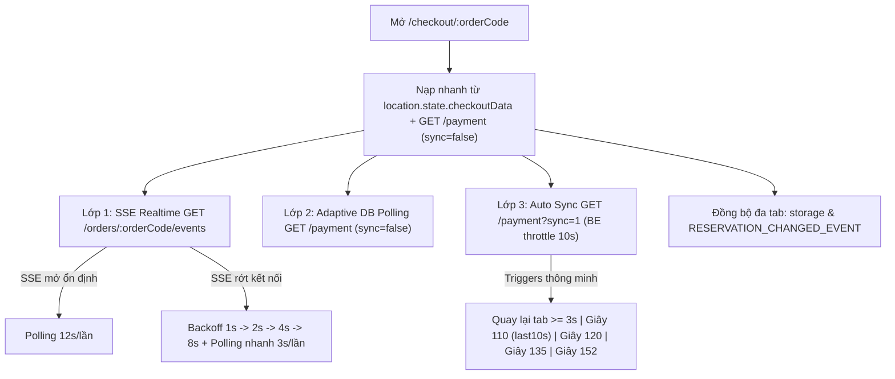

# In-Site PayOS QR Checkout — Tài liệu Frontend (`sell-ticket-fe-demo`)

**Route chính:** `/checkout/:orderCode`  
**Cập nhật:** 2026-11-22  
**Kiểm tra build/lint:** `npm run build` / `npx eslint ...`

---

## 🎯 1. Tổng quan thay đổi

Toàn bộ bước thanh toán đã được đưa về trực tiếp trong ứng dụng Frontend thay vì đẩy người dùng rời khỏi trang:

- **Gỡ bỏ hoàn toàn redirect PayOS (`window.location.href = checkoutUrl`)** và luồng đọc query return cũ (`?cancel=true&status=...`, `recentPendingOrderCode` 90s) trong `EventDetailPage`.
- **Trang thanh toán nội bộ `/checkout/:orderCode` (`CheckoutPage`):** hiển thị mã VietQR (vẽ bằng `qrcode.react`), thông tin chuyển khoản có sao chép 1 chạm, nút tải ảnh QR, bộ đếm ngược đồng bộ theo đồng hồ server và deeplink mở app ngân hàng trên di động.
- **Nguyên tắc cốt lõi:** hệ thống nhận kết quả thanh toán **100% tự động** (SSE realtime + DB polling dự phòng + trigger đối soát thông minh `?sync=1`). **Không có nút "Tôi đã chuyển khoản"** ở bất kỳ đâu trên giao diện.

---

## 📦 2. Thư viện mới & Cài đặt

Sau khi pull nhánh mới về máy, thành viên team FE **cần chạy lại `npm install`** để cài dependency mới trong [package.json](../package.json):

```bash
npm install
```

- **`qrcode.react` (`^4.2.0`):** dùng component `QRCodeCanvas` để render trực tiếp chuỗi VietQR (`paymentInfo.qrCode`) thành canvas và hỗ trợ xuất file PNG khi bấm **"Tải mã QR"**.

---

## 🧭 3. Định tuyến & Luồng điều hướng (`src/App.jsx`)

- **Route mới:** `/checkout/:orderCode` → render `<CheckoutPage />`.
- **Hành vi tối ưu khi đang ở route `checkout`:**
  - Ẩn `<PendingPaymentBanner />` (`currentRoute !== 'login' && currentRoute !== 'checkout'`) để tránh hiện banner đè lên chính trang đang trả.
  - Tạm dừng polling danh sách sự kiện mỗi `10s` (`loadEvents` / `loadUserOrders`) khi đang ở trang `/checkout/:orderCode` nhằm dồn kết nối cho SSE và tránh re-render không cần thiết.
- **Bảo vệ quay lại sau đăng nhập:** nếu user vào thẳng link `/checkout/:orderCode` khi chưa đăng nhập hoặc JWT hết hạn, bấm nút đăng nhập sẽ lưu đường dẫn `/checkout/${orderCode}` vào `sessionStorage['sellticket_after_login_path']`. Sau khi đăng nhập thành công (`handleLoginSuccess` trong [src/App.jsx](../src/App.jsx)), `App` tự động điều hướng trả về đúng trang thanh toán đó.

---

## ⚡ 4. Kiến trúc nhận trạng thái tự động 3 lớp



### 4.1. Lớp 1 — SSE Realtime (`subscribeOrderEvents` trong `src/services/eventService.js`)
- Dùng `fetch()` + `ReadableStream` (`getReader()` + `TextDecoder('utf-8')`) kết hợp `AbortController` để gửi header `Authorization: Bearer <token>` — **không dùng `EventSource` vì không truyền được JWT vào header (tránh lộ token trên URL)**.
- Parse từng block SSE:
  - `event: init` → đồng bộ payload đơn hàng ban đầu và `serverTime`.
  - `event: order_status` → cập nhật tức thì khi có Webhook / Hủy đơn / Cron hết hạn.
  - `: heartbeat` → bỏ qua để giữ kết nối sống.
- Tự xử lý an toàn chunk bị cắt ngang `\r\n`, ngắt stream sạch khi unmount, và khi rớt mạng sẽ tự reconnect theo exponential backoff (`1s → 2s → 4s → 8s`) kèm badge nhỏ `"Đang kết nối lại..."` (không ẩn hay che mã QR).

### 4.2. Lớp 2 — Adaptive DB-Only Polling
- Khi `sseConnected === true`: chỉ đọc nhẹ DB (`sync: false`) mỗi **`12s`** để dự phòng.
- Khi SSE mất kết nối / đang reconnect: tự rút ngắn chu kỳ xuống **`3s`** (`sync: false`).

### 4.3. Lớp 3 — Trigger đối soát PayOS tự động (`?sync=1`)
Hook `useOrderCheckout` chỉ gửi `?sync=1` (BE đã chặn spam 10s/đơn) tại các thời điểm thực sự cần kiểm tra với PayOS:
1. Người dùng chuyển qua App Ngân hàng hoặc tab khác rồi quay lại trang thanh toán (`visibilitychange`) sau **`>= 3 giây`**.
2. **`last10s`**: còn `<= 10 giây` trước khi hết 120s.
3. **`confirmingStart`**: vừa bước sang pha `CONFIRMING` (giây 120).
4. **`confirmingMid`**: còn `<= 15 giây` trong pha `CONFIRMING` (giây 135).
5. **`settle`**: quá `confirmUntil + 2 giây` (giây 152) để chốt trạng thái cuối nếu job nền chưa chạy tới lượt.

### 4.4. Nâng cấp `apiRequest` & đồng bộ đa tab
- `apiRequest()` trong [src/services/eventService.js](../src/services/eventService.js) nay gắn thêm `err.status` và `err.payload` vào đối tượng `Error`, giúp UI phân biệt chuẩn `401/403` (hết phiên JWT), `404` (không tìm thấy/không có quyền) và `409` (xung đột hủy ở pha `CONFIRMING`).
- Lắng nghe đồng thời sự kiện `storage` (`event_reservation_*`) và `RESERVATION_CHANGED_EVENT` để đồng bộ nếu người dùng hủy hoặc thanh toán ở tab khác.

---

## 🧠 5. State Machine & Hook `src/hooks/useOrderCheckout.js`

- **Zero-flash initialization:** khi điều hướng từ `EventDetailPage`, `location.state.checkoutData` được nạp ngay làm dữ liệu khởi đầu để không nháy màn hình loading, đồng thời vẫn gọi ngầm `GET /api/orders/:orderCode/payment` (`sync=false`) để lấy đủ tên sự kiện, địa điểm và danh sách vé. Hỗ trợ đầy đủ khi user bấm F5 hoặc vào từ Banner / Lịch sử đặt vé.
- **Chống lệch giờ thiết bị (`serverOffsetMs`):**
  - Tính `serverOffsetMs = new Date(serverTime).getTime() - Date.now()`.
  - Mỗi giây cập nhật `nowMs = Date.now()` và tính đếm ngược dựa trên hiệu `expiresAt - (nowMs + serverOffsetMs)` (wall-clock), giúp đồng hồ nhảy chính xác ngay cả khi điện thoại khóa màn hình hoặc trình duyệt throttle tab nền.
- **Xử lý hủy đơn & Race Condition (`409 Conflict`):** `cancelCurrentOrder()` gọi `POST /api/orders/:orderCode/cancel`; nếu BE trả `409` (vừa chuyển khoản thành công hoặc vừa nhảy sang pha `CONFIRMING`), hook tự động load lại DB (`sync: false`) để màn hình chuyển đúng trạng thái thật.
- **Dọn phiên & hiệu ứng:** khi đạt trạng thái kết thúc, hook tự dọn khóa `event_reservation_*` khớp `orderCode` trong `localStorage`, gọi callback `onOrderUpdated` để làm mới lịch sử đơn và bắn `confetti` 1 lần duy nhất khi `SUCCESS`.

| Giá trị `uiState` | Điều kiện | Giao diện hiển thị ở `CheckoutPage` |
| :--- | :--- | :--- |
| `AUTH_REQUIRED` | Chưa có JWT token | Card yêu cầu đăng nhập (lưu `sellticket_after_login_path`) |
| `AUTH_EXPIRED` | SSE hoặc API trả `401`/`403` | Card báo hết phiên đăng nhập + nút đăng nhập lại |
| `NOT_FOUND` | API/SSE trả `404` hoặc lỗi tải ban đầu | Card báo không tìm thấy đơn hoặc không thuộc quyền sở hữu |
| `LOADING` | Đang tải dữ liệu và chưa có `initialCheckoutData` | Skeleton khung card 2 cột đồng bộ chiều cao |
| `WAITING` | `PAYMENT_PROCESSING` và chưa tới `expiresAt` (`0..120s`) | Card QR chính + thông tin CK + nút sao chép + nút Hủy + Deeplink mobile |
| `CONFIRMING` | `PAYMENT_PROCESSING` và đã qua `expiresAt` (`120..150s`) | Làm mờ mã QR + overlay progress 30s `"Đang xác nhận giao dịch..."` + **ẩn nút Hủy** |
| `SUCCESS` | `status === 'SUCCESS'` | Xác nhận tự động thành công, tóm tắt vé + nút mở `ETicketModal` |
| `REFUND_PENDING` | `status === 'REFUND_PENDING'` hoặc `'REFUNDED'` | Giải thích giao dịch quá hạn 2 phút sẽ được hoàn tiền + nút sang `/profile#bank` |
| `CANCELLED` | `status === 'CANCELLED'` | Thông báo đơn đã hủy & mở lại ghế + nút `"Chọn lại ghế"` |
| `EXPIRED` | `status === 'EXPIRED'` hoặc `'FAILED'` | Thông báo hết thời gian giữ chỗ/thanh toán + nút `"Chọn lại ghế"` |

---

## 🎨 6. Thiết kế UI/UX (`src/pages/CheckoutPage.jsx` & `CheckoutPage.css`)

- **Bố cục:** 1 card trung tâm gọn nhẹ theo chuẩn PayOS (Header mã đơn & pill đếm ngược → thanh lưu ý → thân 2 cột: Trái hiển thị VietQR, Phải hiển thị thông tin ngân hàng & nút Hủy).
- **Theme:** Đồng bộ hoàn toàn với **TicketVerse Dark Cyber Glassmorphism** (`--bg-dark`, indigo `#6366f1`, cyan `#06b6d4`, amber `#f59e0b`, emerald `#10b981`). Riêng phần hộp đặt `QRCodeCanvas` sử dụng **nền trắng tinh `#ffffff`** kèm 4 góc khung indigo để camera của mọi app ngân hàng nhận diện mã QR tức thì trên nền tối.
- **Tiện ích người dùng:**
  - Nút **"Tải mã QR"** tải ảnh PNG `TicketVerse-QR-${orderCode}.png`.
  - Sao chép 1 chạm (`co-copy-pill`) cho Số tài khoản, Số tiền (số nguyên sạch), và Nội dung chuyển khoản; tự động đổi trạng thái `"Đã chép"` trong 1.8 giây.
  - Modal xác nhận hủy nhẹ (`Esc` để đóng, cảnh báo không hủy nếu đã lỡ chuyển tiền).

---

## 📱 7. Hỗ trợ Mobile Bank Deeplinks (`vietqrDeeplink.js` & `MobileBankDeeplinks`)

- **Phạm vi hiển thị:** chỉ render trên iOS và Android (`detectMobileOS()` trả `'ios'` hoặc `'android'`, tự ẩn trên Desktop và ẩn khi sang pha `CONFIRMING`).
- **Tải & cache Public API VietQR (TTL 30 phút, in-memory + `sessionStorage`):**
  - Danh sách ngân hàng (`https://api.vietqr.io/v2/banks`, đọc mảng `json.data`) để hiển thị tên viết tắt + logo ngân hàng thụ hưởng.
  - Danh sách app theo OS (`https://api.vietqr.io/v2/android-app-deeplinks` và `ios-app-deeplinks`, đọc mảng `json.apps` và fallback `json.data`).
- **Phân tách thông minh (`splitBankApps`):** sắp xếp giảm dần theo `monthlyInstall`, tách 2 nhóm:
  1. **Nhóm `autofill === 1` (hiện trực tiếp ở trên):** gắn badge `"Tự điền"`, dựng link `https://dl.vietqr.io/pay?...` tự động truyền `ba` (`accountNumber@bankCode`), `am` (số tiền), `tn` (nội dung chuyển khoản), `bn` (tên chủ TK) cho các app ngân hàng hỗ trợ tự điền thông tin từ VietQR.
  2. **Nhóm `"Ngân hàng khác"` (mặc định thu gọn):** kèm hộp hướng dẫn 2 bước (Bấm *Tải mã QR* → Mở app chọn *Quét QR từ thư viện*).
- **An toàn & không chặn UI:** validate toàn bộ URL ảnh/deeplink qua `isSafeHttpsUrl()`; nếu VietQR public API chậm hoặc lỗi, phần mã QR chính vẫn hoạt động bình thường.

---

## 🔗 8. Tích hợp các trang & component liên quan

| File | Vai trò nâng cấp |
| :--- | :--- |
| [src/utils/paymentSession.js](../src/utils/paymentSession.js) | Thêm `confirmUntil` & `phase` vào localStorage snapshot; `getSessionEffectiveExpiryMs()` giữ phiên `PAYMENT_PROCESSING` tới hết `confirmUntil` (150s) thay vì rớt ở giây 120. |
| [src/pages/EventDetailPage.jsx](../src/pages/EventDetailPage.jsx) | Sau `startCheckout()`, lưu snapshot vào `localStorage` và `navigate('/checkout/:orderCode', { state: { checkoutData } })`. Đã gỡ bỏ hoàn toàn code đọc query `?cancel=true&status=...` & loop 90s; chặn hủy tại chỗ nếu đơn đã vào pha `CONFIRMING`. |
| [src/components/PendingPaymentBanner.jsx](../src/components/PendingPaymentBanner.jsx) | Nút `"Tiếp tục thanh toán"` điều hướng nội bộ sang `/checkout/:orderCode`; hỗ trợ nhãn pha `CONFIRMING` (*"Đang xác nhận giao dịch..."*, ẩn nút Hủy); xác thực phiên nền bằng `fetchOrderPayment(..., { sync: false })`. |
| [src/components/BookingSummary.jsx](../src/components/BookingSummary.jsx) | Cập nhật nhãn sang luồng QR nội bộ (*"Thanh toán QR • ..."*, *"Đang tạo mã QR thanh toán..."*). |
| [src/pages/OrderHistoryPage.jsx](../src/pages/OrderHistoryPage.jsx) | Bổ sung nút **"Tiếp tục thanh toán"** cho các đơn `PAYMENT_PROCESSING` vẫn còn nằm trong `confirmUntil` (`nowMs < confirmDeadlineMs`), trỏ thẳng sang `/checkout/:orderCode`. |

---

## 📋 9. Danh sách 15 file Frontend đã thêm / chỉnh sửa

- **Cài đặt:** `package.json`, `package-lock.json` (`qrcode.react`)
- **Mới:**
  - `src/hooks/useOrderCheckout.js`
  - `src/pages/CheckoutPage.jsx` & `src/pages/CheckoutPage.css`
  - `src/components/MobileBankDeeplinks.jsx` & `src/components/MobileBankDeeplinks.css`
  - `src/utils/vietqrDeeplink.js`
- **Cập nhật:**
  - `src/App.jsx`
  - `src/services/eventService.js`
  - `src/utils/paymentSession.js`
  - `src/pages/EventDetailPage.jsx`
  - `src/pages/OrderHistoryPage.jsx`
  - `src/components/PendingPaymentBanner.jsx`
  - `src/components/BookingSummary.jsx`

---

## ✅ 10. Checklist kiểm thử nhanh cho Dev / QA

1. **Khởi tạo & hiển thị QR (Desktop + Mobile):** bấm Thanh toán chuyển ngay sang `/checkout/:orderCode` không nháy màn hình; QR nền trắng quét được trực tiếp bằng app ngân hàng; nút *Tải mã QR* ra file PNG; nút *Sao chép* STK/Số tiền/Nội dung hoạt động chính xác.
2. **Đa nguồn truy cập & F5:** F5 ngay tại `/checkout/:orderCode`, bấm *Tiếp tục thanh toán* trên `PendingPaymentBanner` hoặc ở `OrderHistoryPage` (`/my-tickets`) đều mở lại đúng QR và thời gian đếm ngược khớp server.
3. **Thanh toán thành công tự động:** sau khi chuyển khoản trên app ngân hàng, màn hình tự nhảy `SUCCESS` qua SSE (không bấm bất kỳ nút xác nhận nào), bắn pháo giấy và mở được `ETicketModal`.
4. **Hết 120s sang 30s `CONFIRMING`:** tại giây `00:00`, mã QR mờ đi kèm progress `"Đang xác nhận giao dịch..."` (30s), nút **Hủy** ẩn khỏi card và `PendingPaymentBanner` cũng khóa nút Hủy; hết 150s chuyển thành `EXPIRED` và ghế được mở lại.
5. **Chuyển tiền muộn (`> 120s`):** màn hình chuyển `REFUND_PENDING`, hiển thị lời giải thích quá 2 phút và nút đi tới `/profile#bank`.
6. **Mobile Deeplink:** mở bằng điện thoại (hoặc DevTools Mobile UA), mục *Mở nhanh ứng dụng ngân hàng* hiện nhóm app hỗ trợ `autofill === 1` với badge `"Tự điền"` và mục *"Ngân hàng khác"* thu gọn có hướng dẫn 2 bước.
7. **Build check:** `npm run build` thành công không lỗi.
